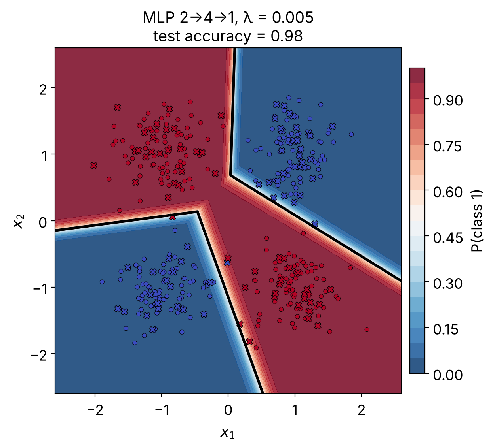

# Why Nonlinearity Is Necessary: Solving XOR with a ReLU MLP from Scratch (NumPy)

**A single layer perceptron cannot learn XOR. A 2→4→1 ReLU network can. This repository shows exactly why, with a proof, a from-scratch backpropagation derivation, L1 sparsity experiments and live, interactive simulations.**

[](https://bastianpd.github.io/xor-nonlinearity-mlp/)
[](https://colab.research.google.com/github/bastianpd/xor-nonlinearity-mlp/blob/main/notebooks/xor_WhyNonLinearity_MLP.ipynb)
[](LICENSE)

Author: **Pedro de Sousa Sebastião**


## Try it

| What | Where |
|---|---|
| Interactive presentation (XOR gate, cluster explorer, live network with sensitivities, results) | https://bastianpd.github.io/xor-nonlinearity-mlp/ |
| Notebook, run it yourself in your own Colab session | [Open in Colab](https://colab.research.google.com/github/bastianpd/xor-nonlinearity-mlp/blob/main/notebooks/xor_WhyNonLinearity_MLP.ipynb) |
| Portfolio page | [`See more`](https://sites.google.com/view/pedro-de-sousa-p2s/home) |

Running the simulations in the browser or in your own Colab copy.

## What is inside

1. **The data**: four Gaussian clusters (σ = 0.35) at the corners of a square, labelled with XOR.
2. **The proof**: four inequalities that no perceptron can satisfy at once, plus the geometric argument (convexity of half-planes). An exhaustive line search confirms that no straight line exceeds 75.7 % training accuracy.
3. **The fix**: a 2→4→1 ReLU MLP, with every equation shown together with its matrix shapes (forward and backward).
4. **L1 regularization on hidden activity**: R = (λ/m)‖A₁‖₁, with its subgradient entering before the ReLU backward step.
5. **Gradient check**: central finite differences on the total objective (relative error ≈ 10⁻¹⁰ to 10⁻⁹).
6. **Geometry**: hidden neurons as lines, linear regions, and a live network where you drag/select parameters and watch activations and sensitivities.

## Results (seed = 67, full-batch GD, lr = 0.5, 5000 epochs)

| Model | Train acc. | Test acc. | Test BCE | Fraction of A₁ = 0 (train) | Mean \|A₁\| (train) |
|---|---|---|---|---|---|
| Logistic regression | 0.657 | **0.540** | 0.7067 | n/a | n/a |
| MLP, λ = 0 | 1.000 | **0.980** | 0.0332 | 0.538 | 1.661 |
| MLP, λ = 0.005 | 1.000 | **0.980** | 0.0565 | 0.620 | 0.759 |

L1 with λ = 0.005 makes the hidden layer sparser (54 % → 62 % exact zeros, mean activation more than halved) without changing accuracy. The λ sweep (`results/lambda_sweep.csv`) shows that sparser is not automatically better: 97 % test accuracy at λ = 0.05, 72 % at λ = 0.5, and a dead network for λ ≥ 2.



All figures are in [`docs/figures`](docs/figures); the numbers are in [`results/`](results).

## Repository layout

```
.
├── docs/                    # GitHub Pages site (presentation + figures)
│   ├── index.html
│   └── figures/*.png
├── notebooks/
│   └── xor_WhyNonLinearity_MLP.ipynb
├── portfolio/
│   └── xor-nonlinearity.html   # standalone page
├── results/                 # metrics.csv, lambda_sweep.csv
├── scripts/make_figures.py  # regenerates docs/figures from the notebook code
├── CITATION.cff · LICENSE · requirements.txt
└── .github/CODEOWNERS
```

## Reproduce locally

```bash
pip install -r requirements.txt
jupyter notebook notebooks/xor_WhyNonLinearity_MLP.ipynb   # or open it in Colab
python scripts/make_figures.py                               # rebuilds docs/figures
```

### Reproducibility note

Accuracy, BCE, sparsity and the figures for λ = 0 and λ = 0.005 reproduce to the printed precision on a fresh machine. The exploratory λ sweep is more fragile: for λ ≥ 0.5 the hidden units sit near the ReLU threshold, so tiny floating-point differences between NumPy/BLAS builds can change whether the network collapses (on one test machine λ = 0.5 collapsed to 48 % instead of the 72 % stored in `results/lambda_sweep.csv`). The stored values are the ones from the notebook run.

## Access and editing policy

Everyone can read the repository, open the live presentation and run the notebook. The content is licensed [CC BY-NC-ND 4.0](LICENSE): share with credit, non-commercial, no derivative versions. Only the owner can push changes (no collaborators; `CODEOWNERS` lists the owner; the `main` branch is protected). Please cite using [`CITATION.cff`](CITATION.cff).

## References

Entries marked **[XOR]** address the XOR limitation of the perceptron directly.

1. **[XOR]** Minsky, M., Papert, S. *Perceptrons: An Introduction to Computational Geometry*. MIT Press, 1969 (expanded edition, 1988).
2. Rosenblatt, F. The perceptron: a probabilistic model for information storage and organization in the brain. *Psychological Review*, 65(6), 386–408, 1958.
3. Rumelhart, D. E., Hinton, G. E., Williams, R. J. Learning representations by back-propagating errors. *Nature*, 323, 533–536, 1986.
4. **[XOR]** Rumelhart, D. E., Hinton, G. E., Williams, R. J. Learning internal representations by error propagation. In *Parallel Distributed Processing*, vol. 1, ch. 8. MIT Press, 1986.
5. **[XOR]** Goodfellow, I., Bengio, Y., Courville, A. *Deep Learning*. MIT Press, 2016, §6.1 "Example: Learning XOR". https://www.deeplearningbook.org/
6. Olazaran, M. A sociological study of the official history of the perceptrons controversy. *Social Studies of Science*, 26(3), 611–659, 1996.
7. Cybenko, G. Approximation by superpositions of a sigmoidal function. *Math. Control Signals Systems*, 2, 303–314, 1989.
8. Hornik, K., Stinchcombe, M., White, H. Multilayer feedforward networks are universal approximators. *Neural Networks*, 2(5), 359–366, 1989.
9. Nair, V., Hinton, G. E. Rectified linear units improve restricted Boltzmann machines. *ICML*, 2010.
10. Glorot, X., Bordes, A., Bengio, Y. Deep sparse rectifier neural networks. *AISTATS*, 2011.
11. Montúfar, G., Pascanu, R., Cho, K., Bengio, Y. On the number of linear regions of deep neural networks. *NeurIPS*, 2014. arXiv:1402.1869.
12. **[XOR]** Pinto, R. C., Tavares, A. R. PReLU: Yet another single-layer solution to the XOR problem. 2024. arXiv:2409.10821.

## Keywords

XOR problem · perceptron limitations · multilayer perceptron (MLP) · ReLU · nonlinear activation function · backpropagation from scratch · NumPy · L1 regularization · sparse activations · decision boundary · linear regions · interactive neural network visualization
